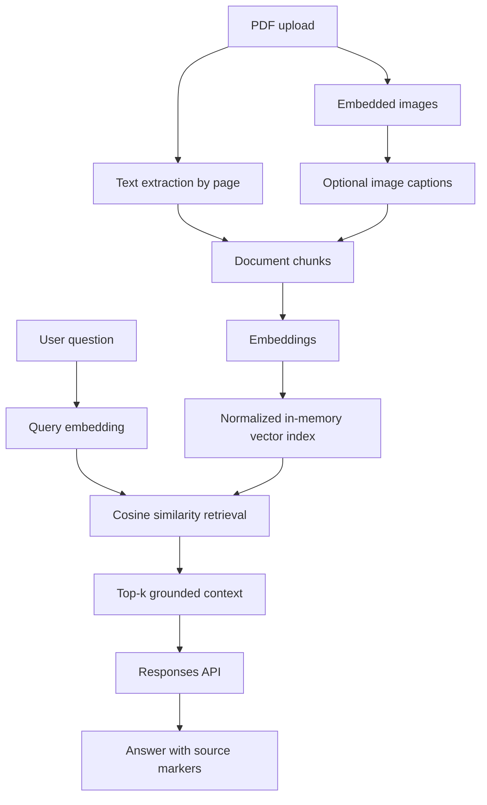

## New local answer engine: GGUF (test branch)

The default answer provider is now `AI_PROVIDER=gguf`: an open-weights
`ggml-org/Qwen3-1.7B-GGUF` Q4_K_M quantized model executed with
`llama-cpp-python`. It runs on CPU by default and keeps OCR, retrieval,
and PDF sources in the app. It does NOT call the paid HF inference router
or require an inference token. Its first answer downloads the public GGUF
weights and may take longer. Subsequent answers reuse the loaded model.

Install the optional local runtime (Windows Python 3.12):

```powershell
python -m pip install -r requirements.txt
python -m pip install llama-cpp-python --extra-index-url https://abetlen.github.io/llama-cpp-python/whl/cpu
$env:AI_PROVIDER="gguf"
python -m streamlit run app.py
```

If the prebuilt wheel cannot be installed, follow the official
llama-cpp-python installation guide. To run the old Transformers
implementation for comparison, explicitly set `AI_PROVIDER=open`.
Neither mode requires a token for inference; the first model download
requires internet access. This GGUF implementation and hosting RAM use
must be benchmarked before public deployment.

## Hugging Face hosted answers (experimental)

This opt-in mode tries to move **answer generation only** to Hugging Face Inference Providers. If the token is absent or the remote service fails (such as HTTP 401, quota or timeout), the application automatically uses local Qwen and avoids further remote attempts for that Streamlit session. The local fallback can still be slow on CPU.
PDF extraction, OCR, embeddings, retrieval, and source viewer remain on the Streamlit host.

Install with `python -m pip install -r requirements.txt`, then configure:

```bash
AI_PROVIDER=hf
HF_TOKEN=your_Hugging_Face_token
HF_CHAT_MODEL=Qwen/Qwen3-4B-Instruct-2507
```

On Streamlit Community Cloud, use **App settings → Secrets** to set `HF_TOKEN`
and `AI_PROVIDER = "hf"` as private secrets. Both are read directly by the Streamlit app. Never commit tokens.

Inference Providers can have tiny free allowances, rate limits, or unavailable
model/provider combinations. Confirm the chosen model actually has a live
provider in your HF account before a public launch. Requests transmit only the
retrieved document excerpts and question to the remote provider, **not the whole
PDF**, but excerpts can still contain private data. Do not test with sensitive
documents without understanding this processing.

The app keeps original cited PDF regions clickable, and measures retrieval and
generation time separately. The HF path is not enabled automatically and has not
been live benchmarked.

## Experimental visual understanding (opt-in)

PDF processing detects larger embedded raster figures without running a visual language
model. Detection is not semantic classification: some detected pictures may be decorative,
and vector-only charts might not be detected.

For experimental visual descriptions, install `pip install -e ".[open,docling,vision]"`
and set `VISUAL_CAPTIONS=true` on the **host**, not in the public user interface.
The default model is `HuggingFaceTB/SmolVLM2-500M-Video-Instruct`. At most two
embedded figures per document are captioned, each with a short output limit.
Generated descriptions are indexed with page and region references and can be wrong;
inspect the original PDF before trusting numeric information in graphs.

**Important:** This feature is off by default in Streamlit Community Cloud. It may
consume too much CPU time or RAM to be suitable for free hosting. Compare latency,
memory and response quality before enabling it publicly. Digital text extraction and
Docling OCR remain separate processing paths; the experimental visual model does
not replace OCR. Full-page scanned backgrounds are excluded from figure detection.

# Document AI Assistant

A source-grounded **PDF RAG assistant**, with **open-weight models by default** and an optional OpenAI provider.

## Quick start (no API key)

Requires Python 3.11+ and enough host memory for CPU inference.

```bash
python -m venv .venv
source .venv/bin/activate  # Windows: .venv\\Scripts\\activate
pip install -e ".[open,dev]"
streamlit run app.py
```

The first start downloads the selected public model weights **to the machine running Streamlit**, not to visitors' browsers. By default:

- **Embeddings:** `sentence-transformers/paraphrase-multilingual-MiniLM-L12-v2`
- **Generation:** `Qwen/Qwen3-0.6B` (CPU inference; slower than hosted accelerated inference)
- **Vector search:** normalized NumPy cosine similarity
- **PDF extraction:** PyMuPDF
- **Image captioning:** off by default; optional in OpenAI mode only

## CPU-first performance and hosting

Streamlit Community Cloud does not provide a GPU assumption for this demo. The app
uses CPU-compatible inference and Docling OCR defaults to RapidOCR's ONNX Runtime
backend, with Spanish recognition (`iso:es`). Set `DOC_OCR_BACKEND=torch`
to compare its alternative backend. Install the declared `[open,docling]`
extras (the deployment `requirements.txt` does this).

Processed PDFs and their embeddings are reused **within the same user's Streamlit
session** by a content digest, even if the uploader is temporarily cleared. The
"Clear documents" control deletes this session's processed cache. No shared
cross-user PDF cache is used because uploads may contain private data.

The first OCR run may download model assets; warm runs may be faster.
Benchmark actual OCR and generation latency separately before considering the
demo production-ready. The current local Transformers Qwen model always runs on
CPU; NVIDIA hardware on a developer machine is not available on Community Cloud.

## Multi-document workspace and citation viewer

The Streamlit interface accepts multiple PDF uploads in one session. You can search
all uploaded files or scope questions to one file. Each retrieved excerpt carries
a PDF filename and page number. The source viewer renders the original page and
highlights a source region **only when Docling provides valid location coordinates**.
Some scanned or reconstructed elements may have no usable coordinates, so the page
is shown without a highlight rather than showing a misleading position.

The hosted application **must install the Docling extra** for OCR:
```bash
pip install -e ".[open,docling]"
```
The app deliberately reports an error when Docling is missing instead of silently
using a no-OCR fallback. First use may download OCR/layout models. CPU deployments
may take several minutes for large scans. Deploy with bounded memory and processing
time, and validate performance before publishing a public link.

The user interface provides Spanish and English labels. Model responses are
requested in the language of the question; language fidelity must be tested.

## Structured extraction with Docling

Install `pip install -e ".[open,docling,dev]"` for the recommended document pipeline.
Docling parses PDFs with OCR and table-structure analysis and preserves page attribution
for extracted fragments. The original PyMuPDF implementation remains available as a
fallback when Docling is not installed. OCR is CPU-intensive and the first run may
download model assets to the host. Do not assume CPU hosting can process large PDFs quickly.

Qwen3 reasoning stays enabled; only its final answer is presented, never the `<think>` block.
OpenAI remains configured through `AI_PROVIDER=openai` in the host environment (not a
visitor-facing radio button). Set `OPENAI_API_KEY` securely for that mode.

The open model is a small experimental baseline: citation correctness, answer quality, Spanish performance and CPU latency need empirical validation. A model being open-weight does **not** mean hosted compute is unlimited or free.

## Optional OpenAI mode

Install base dependencies with `pip install -e ".[dev]"`, launch Streamlit and select **OpenAI (own key)** in the sidebar. The key is entered per session and is not saved to repository files by the application. Never commit or share credentials. The optional image-caption flow uses OpenAI too.

### Data handling and deployment

PDF content is processed on the Streamlit host, and may go to OpenAI only when that provider is selected. **Do not upload sensitive documents to an untrusted public demo.** Public deployments should add rate limiting, session/memory bounds, download/cache controls and a retention policy; these safeguards are not yet complete. Hosted inference, capacity and pricing depend on the chosen deployment environment. No public demo has been verified yet.

---

A compact **multimodal Retrieval-Augmented Generation (RAG)** application for asking grounded questions about PDF documents.

This project evolved from earlier document-QA and chatbot experiments. The current implementation keeps the focus on document understanding while rebuilding the architecture around explicit, testable components.

## What it demonstrates

- PDF text extraction with page-level provenance
- Optional image extraction and AI-generated image captions
- Semantic embeddings and transparent in-memory cosine retrieval
- Grounded question answering through the OpenAI Responses API
- Source markers in generated answers
- Streamlit user interface with retrieved-context inspection
- Unit-tested retrieval logic with no external service dependency

## Architecture



The vector index is deliberately implemented with normalized NumPy arrays rather than hidden behind a framework. For a single-document portfolio demo this keeps retrieval behavior easy to inspect, test, and explain. A production deployment could replace it with a persistent vector database without changing the ingestion and generation boundaries.

## Project structure

```text
.
├── app.py
├── src/document_ai/
│   ├── config.py
│   ├── llm.py
│   ├── models.py
│   ├── pdf.py
│   └── retrieval.py
├── tests/
│   └── test_retrieval.py
├── .env.example
└── pyproject.toml
```

## Local setup

Requirements: **Python 3.11+**. Install the `open` extra for local inference, or the base dependencies for optional OpenAI mode.

```bash
python -m venv .venv
source .venv/bin/activate        # macOS/Linux
# .venv\Scripts\activate       # Windows

pip install -e ".[dev]"
cp .env.example .env
```

Choose **OpenAI (own key)** and provide your key in the UI, then run:

```bash
streamlit run app.py
```

## Configuration

| Variable | Purpose | Default |
|---|---|---|
| `OPENAI_API_KEY` | Optional API credential | optional |
| `OPENAI_CHAT_MODEL` | Answering + optional image-caption model | `gpt-5.6-luna` |
| `OPENAI_EMBEDDING_MODEL` | Embedding model | `text-embedding-3-small` |
| `ENABLE_IMAGE_CAPTIONS` | Image captions in OpenAI mode | `false` |
| `TOP_K` | Retrieved chunks per question | `5` |

## Quality checks

```bash
pytest
ruff check .
```

The unit tests intentionally cover retrieval behavior without calling OpenAI, so they can run cheaply in CI.

## Design decisions

### Why not a heavy RAG framework?

The original experiment used LangChain. The modernization removes it from the core retrieval path so that chunking, embeddings, ranking, provenance, and prompting are visible in the repository. This makes the project easier to evaluate technically and reduces framework coupling.

### Why in-memory retrieval?

This demo targets one uploaded PDF per session. For that workload, a persistent vector database would add infrastructure without demonstrating better retrieval. The `retrieval.py` boundary is intentionally small so FAISS, pgvector, Qdrant, or another backend can be added later.

### Why turn images into captions?

The earlier project already experimented with image-aware PDF understanding. Image captions keep that capability while making both text and visual information searchable through the same retrieval path.

## Validation roadmap

The architecture is in place; the next validation work is:

- run against representative PDFs: text-only, reports with charts, and mixed layouts
- build a small retrieval evaluation set with expected source pages
- measure retrieval quality, latency, and API usage
- add screenshots / a short demo
- decide on deployment and license

## Project evolution

The current implementation supersedes the earlier document-QA and chatbot prototypes and is the maintained version of the project.
